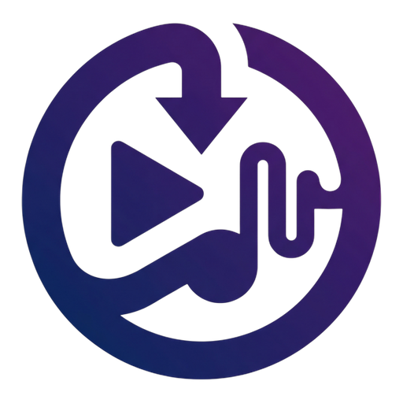
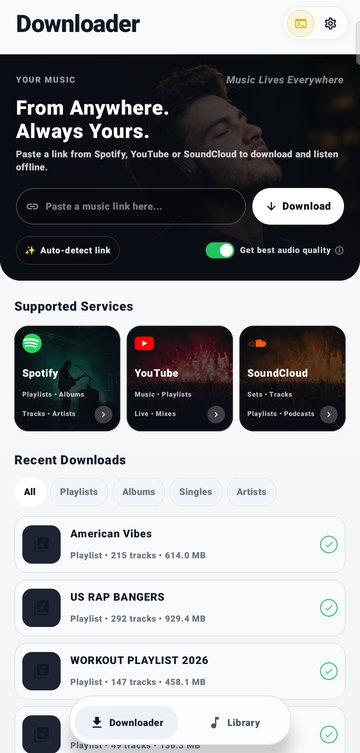
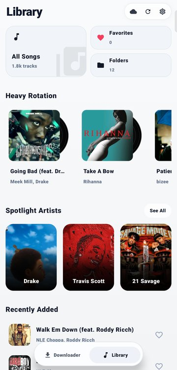
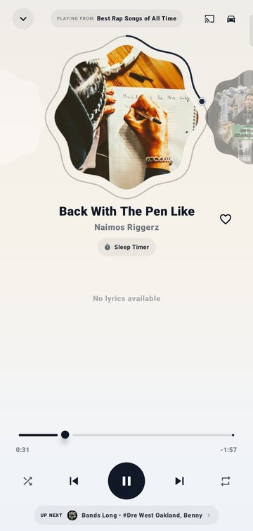
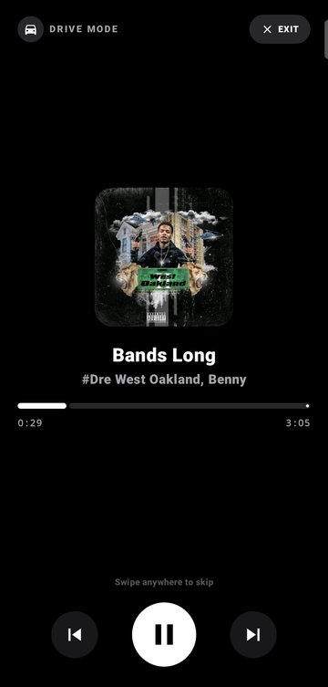
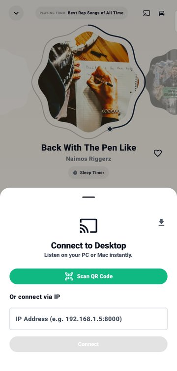

<div align="center">



# Sonixy

### Free music downloader & offline player for Android and Windows

Paste a link from **Spotify, YouTube, SoundCloud, Deezer, Apple Music, TikTok** and more, and get properly tagged tracks with album art and synced lyrics, ready to play offline.

[](https://github.com/nourddinak/sonixy/releases/latest)
[](https://github.com/nourddinak/sonixy/releases)
[](https://github.com/nourddinak/sonixy/stargazers)
[](LICENSE)
<br/>
[](https://github.com/nourddinak/sonixy/releases/latest)
[](https://github.com/nourddinak/sonixy/releases/latest)

**[🌐 Website](https://nourddinak.github.io/sonixy/)** ·
**[📥 Download](https://github.com/nourddinak/sonixy/releases/latest)** ·
**[📋 Changelog](RELEASES.md)** ·
**[🐞 Report a bug](https://github.com/nourddinak/sonixy/issues/new)**

<br/>







</div>

---

## 📥 Download

| Platform | Version | Size | Download |
| :--- | :---: | :---: | :--- |
| **Android** (7.0+) | **v1.3.1** | ~38.0 MB | [**sonixy-v1.3.1-release-signed.apk**](https://github.com/nourddinak/sonixy/releases/download/v1.3.1/sonixy-v1.3.1-release-signed.apk) |
| **Windows** (10 / 11) | **v1.2.6** | ~106.4 MB | [**Sonixy-Desktop-Setup-1.2.6.exe**](https://github.com/nourddinak/sonixy/releases/download/v1.2.6/Sonixy-Desktop-Setup-1.2.6.exe) |

> Only download Sonixy from this repository's [Releases page](https://github.com/nourddinak/sonixy/releases) or the [official website](https://nourddinak.github.io/sonixy/). Check the SHA-256 hashes [below](#-verify-your-download).

---

## ✨ Why Sonixy

- 🔗 **One link, any source.** Single tracks, albums, playlists and artist pages.
- 🏷️ **Clean files.** Title, artist, album, year, track number and high-res cover art written into every file.
- 🎤 **Synced lyrics.** Karaoke-style timed lyrics, fetched automatically from LRCLib and saved as `.lrc`.
- 📴 **Built for offline.** Your music lives on your device, organized by folders, artists, albums and playlists.
- 🆓 **Free, no ads, no account.**

## 🌍 Supported sources

| Music | Video & social | Anything else |
| :--- | :--- | :--- |
| Spotify · YouTube Music · SoundCloud · Bandcamp · Deezer · Apple Music · Tidal · Mixcloud | YouTube · TikTok · Instagram · X (Twitter) · Facebook · Vimeo · Dailymotion · Twitch | Any **web link** supported by `yt-dlp` |

## 🚀 Features

### Downloader
- Fast downloads that keep running with the screen off, thanks to a foreground keep-alive service.
- Smart track matching and metadata tagging, with a logo and colour for each source.

### Android player
- Smooth 60 fps Jetpack Compose UI with a swipe-to-dismiss full-screen player.
- Library tabs for **Folders, Artists, Albums and Playlists**, with batch move, delete and search.
- 🚗 **Drive Mode**: a high-contrast AMOLED in-car screen with big 80 dp touch targets and swipe-to-skip.
- ⏱️ **Sleep timer**, Reels-style music video feed, and an in-app feedback hub.

### Windows desktop companion
- Ambient player that picks up colours from the album art.
- 📡 **LAN sync**: find and control desktop playback from your phone over Wi-Fi (mDNS).
- Automatic background updates.

---

## 📲 Installation

<details open>
<summary><b>Android</b></summary>

1. Download [**`sonixy-v1.3.1-release-signed.apk`**](https://github.com/nourddinak/sonixy/releases/download/v1.3.1/sonixy-v1.3.1-release-signed.apk).
2. Open the file from your notifications or file manager.
3. Allow **"Install unknown apps"** if Android asks.
4. Open Sonixy, paste a link, and press download.

</details>

<details>
<summary><b>Windows</b></summary>

1. Download [**`Sonixy-Desktop-Setup-1.2.6.exe`**](https://github.com/nourddinak/sonixy/releases/download/v1.2.6/Sonixy-Desktop-Setup-1.2.6.exe).
2. Run the installer. It adds a desktop shortcut.
3. Updates install automatically from then on.

</details>

---

## 🔐 Verify your download

```powershell
Get-FileHash -Algorithm SHA256 .\sonixy-v1.3.1-release-signed.apk
```

| File | SHA-256 |
| :--- | :--- |
| `sonixy-v1.3.1-release-signed.apk` | `D7D393705B1B87F1FDD0134897AA72526734514672D6D9793A73B5322EB9039F` |
| `Sonixy-Desktop-Setup-1.2.6.exe` | `5739372F94AFCE120A00BC7C1BA233A402DFF077CD74E6FDC98825CBD8E94DC6` |

Hashes for older versions are in [`releases/README.md`](releases/README.md).

---

## ❓ FAQ

<details>
<summary><b>Is Sonixy free?</b></summary>
Yes. Sonixy is free to download and use, with no ads, no subscription and no account.
</details>

<details>
<summary><b>Is it on the Google Play Store?</b></summary>
Not yet. Install the APK from the <a href="https://github.com/nourddinak/sonixy/releases/latest">Releases page</a>.
</details>

<details>
<summary><b>Android says the app is from an unknown source. Is it safe?</b></summary>
That warning shows for every app installed outside the Play Store. Download only from this repo or the official website, and compare the SHA-256 hash above.
</details>

<details>
<summary><b>Is the source code available?</b></summary>
No. Sonixy is freeware: the apps are free to use, but the source code is closed. See <a href="LICENSE">LICENSE</a>.
</details>

---

## 🛠️ Built with

**Android:** Kotlin · Jetpack Compose · Media3 / ExoPlayer · Chaquopy (embedded Python) · Coroutines & Flow · Ktor · Material 3
**Desktop:** Electron · Vite · Tailwind CSS · WebSockets · Bonjour / mDNS
**Engine:** Python · `yt-dlp` · SpotDL resolver · Mutagen tagger

---

## ⚖️ Disclaimer

Sonixy is a tool for personal use. Respect copyright and the terms of service of the platforms you download from. Only download content you have the right to. Sonixy is not affiliated with Spotify, YouTube, or any other platform named here.

## 📄 License

Sonixy is **freeware**: free to download and use, closed source. Redistribution, resale and reverse engineering are not allowed. See [`LICENSE`](LICENSE) for the full terms.

<div align="center">

<br/>

**If Sonixy is useful to you, please ⭐ star the repo. It helps others find it!**

Made with ❤️ by [nourddinak](https://github.com/nourddinak)

</div>
